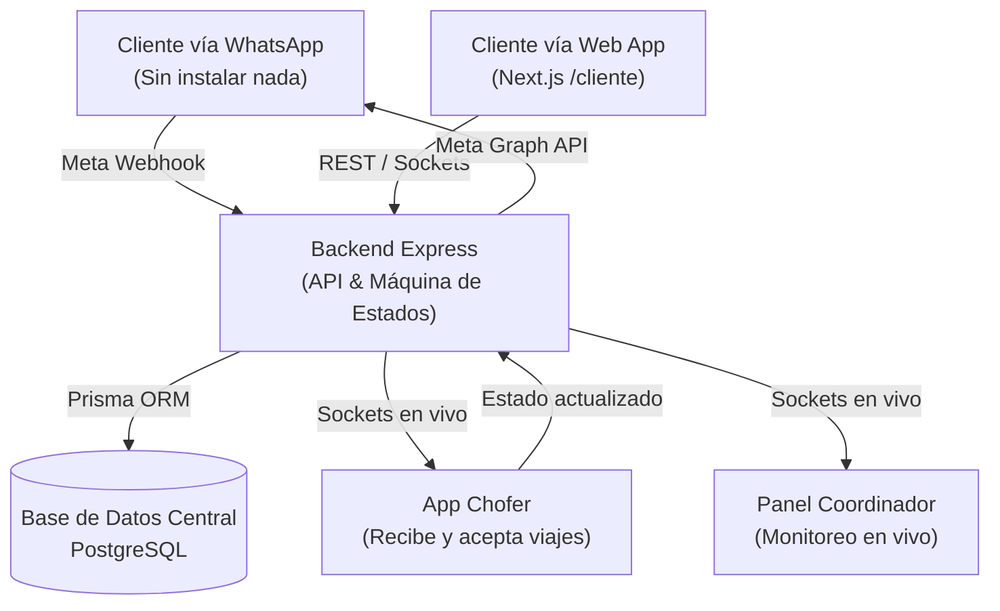
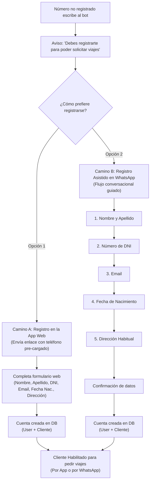
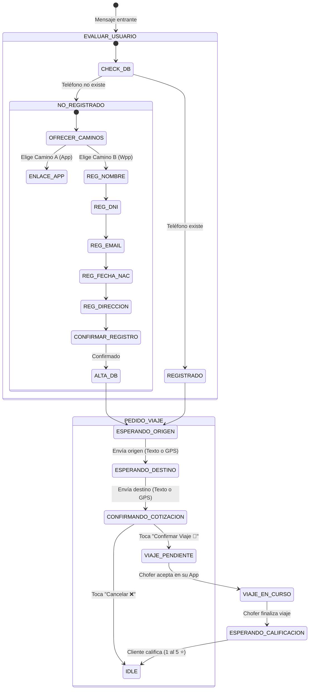

# Guía de Implementación Futura: Bot de WhatsApp (Meta Cloud API) + Convivencia con App de Clientes

Este documento describe la arquitectura, los requisitos previos y el paso a paso detallado para implementar el **Bot Oficial de WhatsApp (Meta Cloud API)** conectado a la central de **AppRemises**, garantizando la **convivencia total y transparente** con la aplicación web/móvil de clientes existente y un **proceso estricto de registro**.

---

## 1. Principio de Convivencia (App Cliente + WhatsApp)

El sistema centraliza todos los pedidos en una única fuente de verdad:

* **Identidad unificada por Teléfono:** Tanto la App del Cliente (`/cliente` / `/registro`) como el Bot de WhatsApp reconocen al usuario por su número de teléfono (`Cliente.telefono`).
* **Mismo modelo de datos (`Viaje`):** Un viaje solicitado por WhatsApp es idéntico a un viaje solicitado desde la App web. Los choferes y coordinadores lo visualizan, aceptan y gestionan en el mismo panel en tiempo real.
* **Historial sincronizado:** Si un cliente pide un auto por WhatsApp y luego inicia sesión en la App del Cliente, verá reflejado su viaje en el historial.



---

## 2. Política de Registro: No hay Auto-Registro Silencioso

Por motivos de **seguridad del chofer, veracidad del usuario y trazabilidad legal**, el bot **no permite solicitar viajes a números anónimos**.

Cuando un número desconocido escribe por primera vez:
1. El sistema verifica si existe en la base de datos `Cliente.telefono`.
2. Al no encontrarlo, el bot le informa educadamente que para poder pedir un remis debe estar registrado.
3. Se le presentan **2 caminos a elección del usuario**:



---

## 3. Detalle de los Dos Caminos de Registro

### Camino A: Registro en la App Web (Autogestión)
El bot envía un mensaje con un botón interactivo o enlace con el teléfono del cliente como parámetro URL:
> *"Para registrarte desde nuestra App Web, ingresá en el siguiente enlace:"*  
> `https://tu-remiseria.com/registro?telefono=+54911xxxxxxxx`

* **Ventajas:**
  * El usuario define su propia contraseña segura.
  * Interfaz visual completa y validación en tiempo real.
  * Una vez que termina en la web, el bot detecta el alta y le escribe por WhatsApp:  
    > *"¡Excelente, Juan! Ya registramos tu cuenta con éxito. ¿Desde qué dirección salís hoy?"*

---

### Camino B: Registro Asistido Paso a Paso por WhatsApp
Si el usuario no quiere salir de WhatsApp ni abrir un navegador, el bot le solicita **los mismos campos obligatorios** requeridos por el modelo `Cliente`:

1. **Nombre y Apellido:** *"¿Cuál es tu Nombre y Apellido completo?"*
2. **DNI:** *"Ingresá tu número de DNI (sin puntos):"* $\rightarrow$ Valida que sean 7 u 8 dígitos numéricos y que no esté duplicado.
3. **Email:** *"¿Cuál es tu correo electrónico?"* $\rightarrow$ Valida formato de email.
4. **Fecha de Nacimiento:** *"¿Cuál es tu fecha de nacimiento? (Ejemplo: 24/05/1992)"* $\rightarrow$ Valida formato de fecha y mayoría de edad.
5. **Dirección Habitual:** *"¿Cuál es tu domicilio o dirección de residencia habitual?"*
6. **Confirmación:**
   > *"Por favor confirmá si tus datos son correctos:\n\n👤 *Nombre:* Juan Pérez\n🪪 *DNI:* 35.123.456\n✉️ *Email:* juan@email.com\n🎂 *Nacimiento:* 24/05/1992\n🏠 *Domicilio:* San Martín 1234\n\n[Confirmar Registro ✅] [Corregir ✏️]"*

Al confirmar:
* El backend crea el registro en `User` (rol `CLIENTE`) con una contraseña provisoria generada automáticamente y el registro en `Cliente`.
* Se le envía un mensaje con sus credenciales de acceso para la App web por si luego desea ingresar desde el navegador.
* Pasa inmediatamente al flujo de solicitud del viaje: *"¡Tu cuenta está lista! 🎉 ¿Desde dónde salís?"*.

---

## 4. Requisitos Previos, Cuentas en Meta y Estrategia de Pruebas

### A. Gestión de Cuentas: Desarrollador vs. Remisería
**Podés ingresar al portal de Meta con tu propia cuenta personal de Facebook.** No necesitás pedirles su usuario ni contraseña.

Meta separa el perfil del **Desarrollador** del **Dueño del Negocio (Business Manager)**:

1. **Opción Recomendada (Invitación al Administrador Comercial de la Remisería):**
   * La remisería ingresa a [business.facebook.com](https://business.facebook.com/) con su cuenta comercial (donde cargan su tarjeta para los consumos de WhatsApp y son dueños legales del número).
   * Van a: **Configuración del Negocio $\rightarrow$ Usuarios $\rightarrow$ Personas $\rightarrow$ Invitar**.
   * Ingresan tu correo electrónico y te asignan rol de **Administrador** o **Desarrollador**.
   * A vos te llega un correo de invitación. Lo aceptás y desde ese instante podés gestionar la App, crear tokens y configurar webhooks desde tu propia cuenta en [Meta for Developers](https://developers.facebook.com/).
2. **Opción "Llave en mano" (Gestionado bajo tu cuenta):**
   * Creás la cuenta de WhatsApp dentro de tu propio Business Manager.
   * La remisería solo te pasa el código SMS de verificación cuando Meta valida el número.
   * En este caso, la facturación de Meta queda en tu tarjeta y vos se la cobrás a la remisería dentro del abono mensual de mantenimiento.

---

### B. ⚠️ Estrategia de Números de Teléfono y Entornos de Prueba (CRÍTICO)

> [!CAUTION]
> **NUNCA conectes el número oficial de la remisería mientras estás desarrollando o haciendo pruebas.**  
> En el segundo en que registrás un número en la API Cloud de Meta, **se desactiva y borra automáticamente de la aplicación móvil de WhatsApp en el celular**, por lo que la agencia dejaría de recibir los pedidos reales de sus clientes en su teléfono actual.

Para desarrollar, probar y simular viajes sin afectar el número en uso, tenés dos alternativas:

#### 1. Número Virtual de Prueba de Meta (Gratis, Sandbox Instantáneo)
* Al activar el producto WhatsApp en la consola de Meta Developers, Meta te asigna automáticamente un **número virtual de prueba gratuito** (generalmente con prefijo `+1 555...`).
* **No requiere comprar ningún chip ni tener ningún celular físico extra.**
* Te permite registrar hasta **5 números de teléfono autorizados** (por ejemplo, tu propio celular y el del dueño de la remisería).
* Podés chatear con el bot desde tu WhatsApp personal exactamente como lo haría un cliente: solicitar autos, recibir cotizaciones y probar los flujos de viaje.

#### 2. Chip Prepago Secundario (Recomendado para Pruebas Piloto)
* Si querés que varios choferes o personas del equipo hagan pruebas reales sin tener que agregarlos manualmente a la lista de prueba de Meta:
  1. Comprás un chip prepago estándar (Tuenti, Claro, Personal, Movistar).
  2. Lo colocás en cualquier teléfono momentáneamente solo para recibir el SMS de verificación de Meta.
  3. Registrás ese número secundario en la API de Meta.
  4. Cualquier persona puede agendar ese número y probar el bot libremente desde Argentina.

---

### C. Procedimiento de Lanzamiento a Producción (Pase a Producción en 5 minutos)

Una vez que todo el flujo esté 100% probado, validado y aprobado:

1. **Liberación del número oficial:** En el celular físico de la remisería, se realiza una copia de seguridad y se selecciona **Ajustes $\rightarrow$ Cuenta $\rightarrow$ Eliminar cuenta** (esto libera el número telefónico para que Meta permita transferirlo a la API Cloud).
2. **Alta oficial en Meta:** En la consola de Meta for Developers vas a **Configuración de la API $\rightarrow$ Agregar número de teléfono** e ingresás el número oficial de la remisería.
3. **Verificación:** Meta envía un SMS o llamada automática al chip de la remisería con un código de 6 dígitos.
4. **Actualización en el servidor:** En el archivo `.env` del backend se actualiza la variable `WHATSAPP_PHONE_NUMBER_ID` con el ID del nuevo número oficial.
5. **En menos de 5 minutos el bot queda operativo atendiendo en el número definitivo de la remisería, 24 horas al día sin depender de un celular físico.**

---

### D. Token de Acceso Permanente (System User)
1. En el Business Manager $\rightarrow$ **Usuarios del Sistema (System Users)** $\rightarrow$ Crear usuario con rol de Administrador.
2. Generar un Token de Acceso con los permisos:
   * `whatsapp_business_messaging`
   * `whatsapp_business_management`
3. Guardar este token permanente en el archivo `.env` del backend.

---

## 5. Variables de Entorno a Agregar en `backend/.env`

```env
# Configuración Meta Cloud API de WhatsApp
WHATSAPP_API_URL=https://graph.facebook.com/v21.0
WHATSAPP_PHONE_NUMBER_ID=tu_phone_number_id_aqui
WHATSAPP_BUSINESS_ACCOUNT_ID=tu_waba_id_aqui
WHATSAPP_ACCESS_TOKEN=tu_token_permanente_aqui
WHATSAPP_VERIFY_TOKEN=token_secreto_personalizado_para_webhook
FRONTEND_URL=https://tu-remiseria.com
```

---

## 6. Arquitectura del Flujo de Conversación (Máquina de Estados)



### Tabla de Estados de Sesión:
| Estado | Acción esperada del usuario | Respuesta del Bot |
|---|---|---|
| `NO_REGISTRADO` | Mensaje entrante no reconocido | Explica que se requiere registro y ofrece: 1) App Web, 2) Por WhatsApp. |
| `REG_WPP_*` | Datos paso a paso (Nombre, DNI, Email, etc.) | Valida cada dato y avanza al siguiente. |
| `IDLE` | Saludo de cliente registrado | Saludo personalizado: *"¡Hola Juan! 👋 ¿Desde dónde salís hoy?"* |
| `ESPERANDO_ORIGEN` | Dirección en texto o Pin de GPS | Guarda origen y solicita destino. |
| `ESPERANDO_DESTINO` | Dirección en texto o Pin de GPS | Calcula distancia (OSRM) y cotiza tarifa con la remisería. |
| `CONFIRMANDO_COTIZACION` | Botón interactivo: "Confirmar" o "Cancelar" | Si confirma, genera el viaje en base de datos. |
| `VIAJE_EN_CURSO` | Pasajero esperando o a bordo | Actualizaciones automáticas (auto en camino, datos del vehículo, auto en puerta). |
| `ESPERANDO_CALIFICACION` | Respuesta del 1 al 5 ⭐ | Guarda feedback en el perfil del chofer. |

---

## 7. Endpoints a Implementar en el Backend

### 1. `GET /api/whatsapp/webhook` (Verificación de Webhook por Meta)
Meta realiza un handshake GET con un token de desafío (`hub.challenge` y `hub.verify_token`):

```typescript
// backend/src/controllers/whatsappWebhookController.ts
export const verificarWebhook = (req: Request, res: Response) => {
  const mode = req.query['hub.mode'];
  const token = req.query['hub.verify_token'];
  const challenge = req.query['hub.challenge'];

  if (mode === 'subscribe' && token === process.env.WHATSAPP_VERIFY_TOKEN) {
    return res.status(200).send(challenge);
  }
  return res.sendStatus(403);
};
```

### 2. `POST /api/whatsapp/webhook` (Recepción de Mensajes y Eventos)
Recibe mensajes de texto, ubicaciones de GPS nativas (`location`), clics en botones interactivos (`interactive`) y confirmaciones de lectura.

* **Recomendación clave:** Retornar `res.status(200).send('EVENT_RECEIVED')` de inmediato y procesar la lógica de forma asíncrona para que Meta no reintente el envío.

### 3. Servicio de Envío (`backend/src/services/whatsappService.ts`)
Encargado de invocar la Graph API de Meta para enviar:
* Mensajes de texto simples.
* Mensajes interactivos con botones (Quick Reply Buttons).
* Mensajes de lista interactiva (si hay varias direcciones frecuentes).

---

## 8. Integración con el Sistema de Choferes Existente

Cuando el chofer interactúe con su aplicación, el backend enviará mensajes automáticos al cliente por WhatsApp sin intervención humana:

### A. Al Aceptar el Viaje (`choferController.aceptarViaje`)
Disparar mensaje de WhatsApp al cliente:
> *"¡Tu viaje fue confirmado! 🚗*\n\n*Chofer:* Carlos Gómez\n*Vehículo:* Fiat Cronos Blanco\n*Patente:* AF 123 CD\n*Tiempo estimado:* 4 minutos\n\n*Te avisaremos cuando esté en tu puerta.*"

### B. Al Llegar al Origen (`actualizarEstadoViaje -> 'EN_CAMINO'`)
Disparar mensaje:
> *"🔔 Tu remis ya está esperando en la puerta de origen."*

### C. Al Finalizar el Viaje (`actualizarEstadoViaje -> 'COMPLETADO'`)
Disparar mensaje de calificación:
> *"¡Gracias por viajar con nosotros! 🏁*\n\n*¿Cómo calificarías la atención de tu chofer? Respondé con un número del 1 al 5 ⭐."*

---

## 9. Manejo de Casos Especiales

1. **Soporte de Ubicación GPS Nativa de WhatsApp:**
   * Meta envía el payload con `location.latitude` y `location.longitude`.
   * El backend usa Nominatim/OSRM inverso para obtener el nombre de calle y altura automáticamente.
2. **Validación estricta de DNI y Email por WhatsApp:**
   * Evita duplicados o errores tipográficos antes de crear el usuario en la base de datos.
3. **Comando de Derivación a Operador Humano:**
   * Si el cliente escribe *"OPERADOR"* o *"HUMANO"*, o si hay dudas en el registro:
     * La sesión entra en estado `HUMAN_TAKEOVER`.
     * Se emite una alerta por Socket al panel del Coordinador: *"Cliente [Teléfono] solicita atención manual por WhatsApp"*.
     * El bot suspende respuestas automáticas hasta que el operador libere la conversación.

---

## 10. Pasos para la Futura Ejecución

Cuando se decida comenzar con el desarrollo, los pasos de código serán:

1. **Paso 1:** Configuración de la App en Meta for Developers y obtención de credenciales.
2. **Paso 2:** Crear la tabla de sesiones de chat (`SesionWhatsApp` en Prisma) para almacenar los pasos de registro y estado del viaje.
3. **Paso 3:** Implementar el módulo de validación y alta de cliente en `whatsappRegistrationService.ts`.
4. **Paso 4:** Crear el servicio `whatsappService.ts` en el backend para enviar mensajes vía Meta Graph API.
5. **Paso 5:** Implementar el webhook `whatsappWebhookController.ts` con la máquina de estados completa.
6. **Paso 6:** Conectar los eventos de chofer (`aceptarViaje`, `EN_CAMINO`, `COMPLETADO`) con los disparadores de WhatsApp.
7. **Paso 7:** Pruebas integrales de registro (Camino A y Camino B) y solicitud de viajes.
