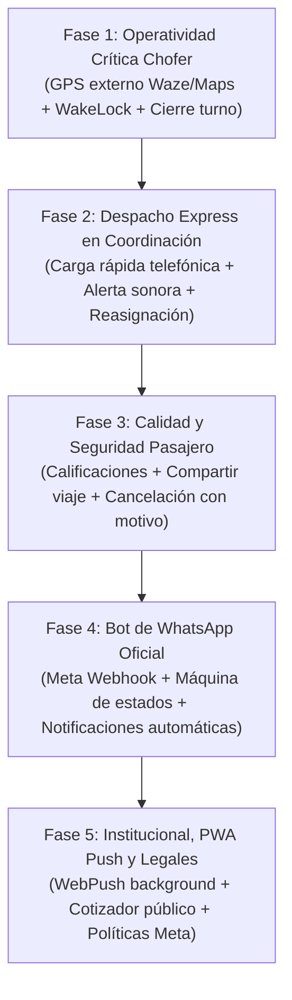

# 📋 Roadmap de Faltantes y Mejoras por Módulo (Excluyendo Admin)
## Sistema de Gestión Remises Bruno / AppRemises

Este documento detalla el diagnóstico exhaustivo de funcionalidades pendientes, optimizaciones críticas y módulos por implementar para llevar la plataforma a un nivel de producción comercial masiva.

---

## 📑 Índice de Módulos Evaluados
- [📋 Roadmap de Faltantes y Mejoras por Módulo (Excluyendo Admin)](#-roadmap-de-faltantes-y-mejoras-por-módulo-excluyendo-admin)
  - [Sistema de Gestión Remises Bruno / AppRemises](#sistema-de-gestión-remises-bruno--appremises)
  - [📑 Índice de Módulos Evaluados](#-índice-de-módulos-evaluados)
  - [1. Módulo Clientes / Pasajeros (PWA)](#1-módulo-clientes--pasajeros-pwa)
    - [✅ Estado Actual](#-estado-actual)
    - [🔴 Funcionalidades Faltantes](#-funcionalidades-faltantes)
  - [2. Módulo Choferes / Móviles (PWA)](#2-módulo-choferes--móviles-pwa)
    - [✅ Estado Actual](#-estado-actual-1)
    - [🔴 Funcionalidades Faltantes](#-funcionalidades-faltantes-1)
  - [3. Módulo Coordinación / Despacho (Central)](#3-módulo-coordinación--despacho-central)
    - [✅ Estado Actual](#-estado-actual-2)
    - [🔴 Funcionalidades Faltantes](#-funcionalidades-faltantes-2)
  - [4. Módulo Bot de WhatsApp (Meta Cloud API)](#4-módulo-bot-de-whatsapp-meta-cloud-api)
    - [🔴 Funcionalidades Faltantes](#-funcionalidades-faltantes-3)
  - [5. Módulo Web Institucional y Portal General](#5-módulo-web-institucional-y-portal-general)
    - [✅ Estado Actual](#-estado-actual-3)
    - [🔴 Funcionalidades Faltantes](#-funcionalidades-faltantes-4)
  - [6. Transversal: Conectividad, Notificaciones PWA y Resiliencia](#6-transversal-conectividad-notificaciones-pwa-y-resiliencia)
    - [🔴 Tareas Técnicas Clave](#-tareas-técnicas-clave)
  - [🎯 Plan de Acción Recomendado (Orden de Prioridad)](#-plan-de-acción-recomendado-orden-de-prioridad)

---

## 1. Módulo Clientes / Pasajeros (PWA)
*Subdominio: `clientes.brunoremises.com.ar` | Rutas: `/cliente/app`, `/cliente/viajes`, `/cliente/reserva`, `/cliente/perfil`*

### ✅ Estado Actual
- Registro y login de clientes con validación.
- Pedido de viajes en tiempo real con cálculo de distancia y tarifa estimada.
- Mapa interactivo con ruta y visualización del móvil asignado.
- Alerta acústica/háptica de "Chofer en la puerta".
- Gestión de direcciones favoritas (Casa, Trabajo, Gym, etc.).
- Historial de viajes realizados y sistema de reservas programadas.

### 🔴 Funcionalidades Faltantes
1. **Sistema de Calificación y Reseñas (1 a 5 estrellas):**
   - Modal al completarse el viaje para calificar al chofer y al estado del vehículo.
   - Tags predefinidos: *"Manejo prudente"*, *"Auto limpio"*, *"Puntual"*, *"Aire acondicionado"*.
   - Comentarios opcionales para control de calidad.
2. **Cancelación de Viaje con Motivo:**
   - Botón de cancelación mientras el viaje está en estado `PENDIENTE` o `EN_CAMINO`.
   - Selector de motivos: *"El chofer demora demasiado"*, *"Cambio de planes"*, *"Pedí por error"*.
   - Notificación sonora inmediata al chofer y al coordinador.
3. **Compartir Viaje en Tiempo Real (Seguridad Pasajero):**
   - Generación de enlace público temporal protegido por token (`brunoremises.com.ar/track/<token>`).
   - Envío directo por WhatsApp a familiares para ver en vivo el auto avanzando hacia el destino.
4. **Botón de Emergencia / SOS:**
   - Acceso rápido a llamada directa al 911 o a la central de la remisería con envío de coordenadas actuales.
5. **Chat Rápido / Mensajería Predefinida con el Chofer:**
   - Mensajes rápidos de 1 toque: *"Ya bajo"*, *"Estoy en la puerta"*, *"Esperame 2 minutos"*, *"No veo el auto"*.
6. **Múltiples Paradas Intermedias:**
   - Posibilidad de agregar una parada previa al destino final con recálculo dinámico de tarifa.
7. **Selección de Método de Pago y Detalle de Cambio:**
   - Elegir entre Efectivo o Transferencia. Si es efectivo: *"¿Con cuánto abona?"* para que el chofer prepare cambio.
8. **Subir a un Móvil en la Calle (Escanear QR Remis / Vincular Viaje Espontáneo):**
   - Si el pasajero toma un remis en la calle o parada que ya tiene disponible, puede abrir su app y escanear el QR del móvil (o ingresar el número de móvil) para vincular el viaje a su cuenta, manteniendo su historial, puntos y método de pago.

---

## 2. Módulo Choferes / Móviles (PWA)

*Subdominio: `choferes.brunoremises.com.ar` | Rutas: `/chofer/app`, `/chofer/gastos`, `/chofer/historial`, `/chofer/perfil`*

### ✅ Estado Actual y Funcionalidades Completadas
- Conexión / Desconexión y sistema de pausas (Almuerzo, Combustible, Baño).
- Recepción de viajes en tiempo real con alerta sonora y cuenta regresiva de aceptación/rechazo.
- Máquina de estados: *"En camino a buscar pasajero"*, *"Llegué a la puerta"*, *"Iniciar viaje"*, *"Finalizar viaje"*.
- Medición de kilometraje en tiempo real con y sin pasajero (Haversine + odometría).
- Carga de gastos operativos (Nafta/Gasoil o GNC, lavado, peaje, reparaciones) con odómetro y fotos de tickets.
- Historial filtrado por turnos y fechas con cierres y liquidaciones.
- **Lanzador Directo a GPS Externo (Google Maps / Waze):** Botones de 1 toque para abrir Google Maps o Waze con las coordenadas y dirección exactas del pasajero o del destino con navegación guiada turn-by-turn.
- **Mantener Pantalla Encendida (Wake Lock API):** Implementado con `navigator.wakeLock.request('screen')`, re-adquisición automática ante `visibilitychange` y badge con toggle manual.
- **Resiliencia de GPS en Segundo Plano y Offline:** Detección de pérdida de conectividad (`online`/`offline`), banner de aviso y búfer de odometría que sincroniza deltas al restablecer conexión.
- **Arqueo y Cierre de Turno del Chofer:** Modal completo al finalizar jornada con total cobrado en efectivo, transferencias, gastos descontados, comisión debida a la agencia y ganancia neta de bolsillo.
- **Calificación del Pasajero por parte del Chofer:** Modal post-viaje con calificación de 1 a 5 estrellas, tags rápidos (*"Puntual"*, *"Amable"*, *"Esperó en puerta"*, *"Propina"*, *"Pasajero conflictivo"*), comentario y actualización automática en base de datos.
- **Turnero / Parada Virtual de Base:** Cola virtual de base (FIFO) para choferes en la agencia con prioridad automática en el algoritmo de despacho óptimo (`batchDispatchService`) y sincronización en tiempo real vía WebSockets.
- **Viaje Espontáneo de Calle / Encadenado con Taxímetro Digital:**
  - *Rotación inmediata en destino:* Botón *"Nuevo Pasajero Aquí Mismo"* que toma el destino anterior como origen instantáneo.
  - *Viaje de calle:* Botón de acción rápida con soporte de pasajero sin app o con app (PIN de 4 dígitos).
  - *Taxímetro digital en vivo:* Panel en tiempo real con bajada de bandera, tarifa dinámica por km recorrido, costo por espera y sincronización con central y liquidación.

### 🔴 Funcionalidades Faltantes
*Todas las funcionalidades críticas y secundarias del Módulo Chofer han sido completadas con éxito.*

---

## 3. Módulo Coordinación / Despacho (Central)
*Subdominio: `coordinacion.brunoremises.com.ar` | Rutas: `/coordinador/dashboard`, `/coordinador/mapa`, `/coordinador/cierre`, `/coordinador/reportes`*

### ✅ Estado Actual y Funcionalidades Completadas
- Dashboard de viajes en tiempo real agrupados por estados (En curso, Pendientes, Completados).
- Asignación manual de chofer y móvil.
- Algoritmo de despacho óptimo por lotes (*Batch Matching* tipo Uber/Cabify).
- Mapa en vivo de flota con estado de cada chofer (libre, en camino, ocupado, en pausa).
- Cierres de turno y liquidación operativa.
- **Carga Ultrarrápida de Viaje Telefónico (Modo Despacho Express - F2):** Formulario modal `< 5s` con autofocus, atajos de teclado (`F2`, `Alt+N`, `Enter` para avanzar y despachar, `Escape` para cerrar) y búsqueda predictiva instantánea de pasajeros habituales por número de teléfono o apellido (`GET /api/coordinador/clientes/predictivo`) con autocompletado de direcciones habituales.
- **Reasignación Rápida de Móvil en Caliente (1 clic):** Botón `🔄 Reasignar` en viajes en curso para transferir de inmediato el viaje a otro móvil disponible ante avería mecánica, pinchadura o demora sin cancelar el pedido ni molestar al cliente. Sincronización instantánea vía WebSockets al móvil saliente, entrante y a la central.
- **Alarma Acústica y Visual en Central para Nuevos Pedidos:** Generador de timbre polifónico armónico tipo campana de recepción central (Web Audio API) con toggle persistente en cabecera (`🔊/🔇`) y banner parpadeante destacado con botón de asignación directa ante pedidos web o WhatsApp entrantes.
- **Tarifa Plana Estándar (Sin Recargos Dinámicos):** Conforme al modelo comercial de Remises Bruno, se mantiene siempre tarifa plana estándar sin incrementos por lluvia ni horario nocturno, garantizando previsibilidad y transparencia al pasajero.
- **Auditoría de Cancelaciones:** Panel analítico dedicado con métricas KPI (total cancelados, por cliente, por chofer, por operador, con viaje mínimo cobrado y recaudación), gráfico de ranking de cuellos de botella por motivo y tabla detallada con filtros rápidos por responsable.
- **Exportación de Reportes a Excel y PDF (Planilla Imprimible):** Descarga de planilla completa de viajes en formato CSV/Excel (UTF-8 BOM) e impresión formal de la planilla de turno con encabezado de Remises Bruno para archivo físico y digital.

### 🔴 Funcionalidades Faltantes
*Todas las funcionalidades críticas y operativas del Módulo Coordinación / Despacho han sido completadas con éxito.*

---

## 4. Módulo Bot de WhatsApp (Meta Cloud API)
*Arquitectura documentada en `IMPLEMENTACION_BOT_WHATSAPP.md` | Estado: Pendiente de Codificación*

### 🔴 Funcionalidades Faltantes
1. **Endpoints de Webhook de Meta:**
   - `GET /api/webhook/whatsapp`: Verificación del Challenge Token de Meta.
   - `POST /api/webhook/whatsapp`: Procesamiento asíncrono de eventos y mensajes entrantes.
2. **Servicio Emisor (Meta Graph API Client):**
   - Envío de mensajes de texto, plantillas interactivas, botones de respuesta rápida (*Quick Replies*) y listas desplegables.
3. **Máquina de Estados Conversacional (FSM):**
   - Manejo de flujo según estado del usuario:
     - *No registrado:* Invitación a registrarse (enlace a web o registro guiado paso a paso en chat).
     - *Registrado:* Menú principal (*Pedir auto ahora*, *Consultar tarifa*, *Mi viaje en curso*, *Hablar con operador*).
4. **Geolocalización por Pin de WhatsApp:**
   - Lectura del mensaje de ubicación de WhatsApp (`location.latitude`, `location.longitude`), geocodificación inversa para obtener la calle/altura y creación del `Viaje`.
5. **Notificaciones Push Automáticas al Pasajero:**
   - Envío de WhatsApp automático cuando el chofer acepta: *"🚖 Tu auto está en camino: Fiat Cronos blanco, Patente AF123BC, Chofer: Carlos"*.
   - Mensaje cuando el auto está en la puerta: *"🔔 Tu remis acaba de llegar a tu puerta"*.

---

## 5. Módulo Web Institucional y Portal General
*Dominio: `brunoremises.com.ar` | Rutas: `/`, `/login`, `/registro`*

### ✅ Estado Actual
- Landing con presentación de servicios y tarjetas de acceso directo por rol.
- Autenticación unificada con JWT y cookies multicanal.

### 🔴 Funcionalidades Faltantes
1. **Cotizador / Estimador de Tarifa Público:**
   - Widget en la portada donde un visitante puede ingresar origen y destino y ver el precio aproximado sin necesidad de crearse una cuenta previamente.
2. **Banners de Instalación PWA (App para Celulares):**
   - Instrucciones ilustradas paso a paso para usuarios:
     - Android: *"Instalar aplicación desde Google Chrome"*.
     - iPhone: *"Compartir ➔ Agregar a pantalla de inicio"*.
3. **Páginas Legales Obligatorias:**
   - Términos y Condiciones del Servicio de Remisería.
   - Política de Privacidad de Datos Personales (requisito excluyente para la verificación de Meta Business y WhatsApp Cloud API).
4. **Sección de Contacto y Teléfonos de Guardia:**
   - Acceso visible al WhatsApp de atención al cliente y teléfonos fijos de la base central.

---

## 6. Transversal: Conectividad, Notificaciones PWA y Resiliencia

### 🔴 Tareas Técnicas Clave
1. **Web Push Notifications (Service Worker):**
   - Configuración de claves VAPID en backend para poder enviar notificaciones push del sistema operativo incluso con la pestaña del navegador cerrada o la pantalla bloqueada (crucial para choferes y clientes).
2. **Indicador de Pérdida de Conexión (Offline Banner):**
   - Si se corta la red 4G en una zona de baja señal, mostrar cartel de aviso: *"Sin conexión a internet. Reintentando..."*, evitando que el chofer piense que el sistema se congeló.
3. **Limpieza y Reintento de Sockets:**
   - Heartbeat periódico para verificar que el chofer sigue transmitiendo GPS cada 5-10 segundos.

---

## 🎯 Plan de Acción Recomendado (Orden de Prioridad)

