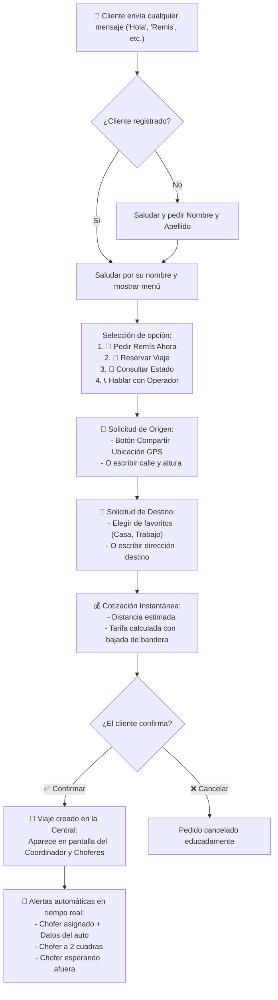
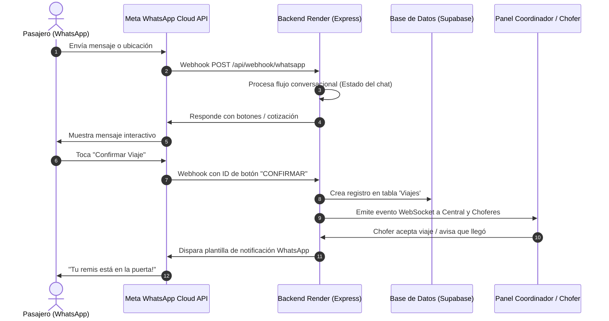

# 📱 Guía Integral de Integración: Bot de WhatsApp para Remises Bruno

Este documento detalla **paso a paso** todo lo necesario para integrar un Bot de WhatsApp conectado en tiempo real con la base de datos y la central de coordinación de **Remises Bruno**, permitiendo que cualquier pasajero pida un auto por WhatsApp y el viaje aparezca automáticamente en la pantalla del coordinador y en la app de los choferes.

---

## 1. Las 2 Alternativas Técnicas: ¿Cuál Elegir?

Para conectar WhatsApp a un backend de Node.js existen dos caminos:

| Característica | 🌟 Opción A: WhatsApp Cloud API (Oficial de Meta) | ⚡ Opción B: Baileys / WhatsApp-Web.js (QR) |
| :--- | :--- | :--- |
| **Tipo de conexión** | API oficial de Meta (Facebook Developers) vía Webhooks | Emulador de WhatsApp Web (escaneando código QR con el celular) |
| **Estabilidad** | 100% estable, no se cae nunca, respaldado por Meta | Depende de mantener la sesión activa; puede requerir reescanear el QR si se cierra |
| **Riesgo de bloqueo** | Cero riesgo de baneo (cumple las políticas oficiales) | Riesgo moderado si Meta detecta automatización |
| **Componentes visuales** | Soporta botones interactivos nativos (`[Confirmar]`, `[Cancelar]`), listas desplegables y lectura de ubicación GPS nativa | Texto plano y ubicación; los botones fueron deprecados por WhatsApp Web |
| **Costo** | **Gratis** las primeras 1.000 conversaciones por mes de atención al cliente (iniciadas por el usuario). Luego centavos de dólar | 100% gratuito |
| **Requisitos** | Un número de teléfono exclusivo para la remisería y una cuenta en Facebook Business | Un teléfono celular con WhatsApp instalado |

> [!TIP]
> **Recomendación para Remises Bruno:**
> La **Opción A (Meta Cloud API)** es el estándar profesional para remiserías y taxis modernos, ya que permite que el cliente toque botones con un solo dedo y comparta su ubicación GPS directamente desde el clip de WhatsApp.

---

## 2. Paso a Paso: ¿Qué Tenés Que Hacer Vos? (Setup Inicial)

Si decidimos ir por la **Cloud API oficial de Meta**:

### Paso 1: Disponer de un número de teléfono
* Necesitás una línea telefónica (chip o número virtual) que **no tenga una cuenta de WhatsApp activa en un teléfono común**.
* Si ya lo tiene, se elimina la cuenta de WhatsApp desde `Ajustes > Cuenta > Eliminar cuenta` para que Meta pueda adoptarlo como número de Business API.

### Paso 2: Crear la App en Meta for Developers
1. Ingresás a [developers.facebook.com](https://developers.facebook.com/) con tu cuenta de Facebook.
2. Tocás en **"Mis Apps"** ➔ **"Crear App"**.
3. Seleccionás el tipo de app: **"Otro"** ➔ **"Negocio" (Business)**.
4. Le ponés de nombre: `Remises Bruno WhatsApp`.
5. En el panel de la app, buscás el producto **"WhatsApp"** y tocás **"Configurar"**.

### Paso 3: Obtener las Claves del API
En la sección **WhatsApp ➔ Configuración de la API**:
* Verás un **Token de acceso temporal** (luego se genera el permanente).
* Un **Identificador de número de teléfono** (`PHONE_NUMBER_ID`).
* Un **Identificador de la cuenta de WhatsApp Business** (`WABA_ID`).

### Paso 4: Vincular el Webhook con tu Backend de Render
En **WhatsApp ➔ Configuración ➔ Webhook**:
* **URL de devolución de llamada**: `https://appremisesbruno.onrender.com/api/webhook/whatsapp`
* **Token de verificación**: Una clave secreta que definimos nosotros (ej: `REMISES_BRUNO_SECRET_2026`).
* **Campos a suscribirse**: Marcás la casilla `messages`.

---

## 3. Flujo Conversacional del Bot (Paso a Paso)

A continuación se ilustra exactamente cómo interactúa el bot con un cliente, cómo se expresan ambos y cómo el bot guía al usuario mediante botones para evitar que escriba mal las direcciones.

---

## 4. Simulación Real de la Conversación

### 🔹 Escenario 1: Saludo y Menú Principal

> **👤 Pasajero:**
> Hola, buenas tardes!

> **🤖 Remises Bruno Bot:**
> 👋 ¡Hola, **Mariano**! Bienvenido a **Remises Bruno**.
> ¿En qué te podemos ayudar hoy?
>
> *(El usuario ve 3 botones en pantalla)*:
> * `[ 🚕 Pedir un Remís ]`
> * `[ 📍 Estado de mi viaje ]`
> * `[ 📞 Hablar con Central ]`

---

### 🔹 Escenario 2: Selección de Origen y Destino

> *(El usuario presiona el botón: `[ 🚕 Pedir un Remís ]`)*

> **🤖 Remises Bruno Bot:**
> 📍 ¿Dónde te pasamos a buscar?
> 
> Podés:
> 1. Tocar el botón de abajo: **"📍 Enviar mi ubicación actual"**
> 2. O escribir la calle y altura (ej: *Rivadavia 250*).

> **👤 Pasajero:**
> *(Envía su ubicación GPS o escribe: "Av. Sarmiento 480")*

> **🤖 Remises Bruno Bot:**
> ✅ **Origen confirmado:** Av. Sarmiento 480.
> 
> 🏁 ¿Hacia dónde te llevamos?  
> *(Si tiene direcciones frecuentes, aparecen como opciones)*:
> * `[ 🏠 Mi Casa (Pellegrini 120) ]`
> * `[ 🏢 Trabajo (Belgrano 340) ]`
> * `[ ✍️ Escribir otra dirección ]`

> **👤 Pasajero:**
> *(Toca: `[ 🏠 Mi Casa (Pellegrini 120) ]`)*

---

### 🔹 Escenario 3: Cotización y Confirmación

> **🤖 Remises Bruno Bot:**
> 📋 **Resumen de tu viaje:**
> ━━━━━━━━━━━━━━━━━━━
> 🟢 **Origen:** Av. Sarmiento 480  
> 🔴 **Destino:** Pellegrini 120  
> 📏 **Distancia:** ~2.4 km  
> 💵 **Precio estimado:** **$3.800** *(Efectivo / Transferencia)*  
> ⏱️ **Móvil más cercano:** a 4 minutos  
> ━━━━━━━━━━━━━━━━━━━
> ¿Deseas solicitar el móvil ahora?
>
> *(Botones interactivos)*:
> * `[ ✅ Confirmar Pedido ]`
> * `[ ❌ Cancelar ]`

---

### 🔹 Escenario 4: Disparo a Central y Notificaciones en Vivo

> *(El usuario presiona: `[ ✅ Confirmar Pedido ]`)*

> **🤖 Remises Bruno Bot:**
> 🚕 **¡Pedido confirmado!** Tu viaje #148 ya fue recibido por nuestra central. Estamos asignándote el mejor móvil disponible. Te avisamos por acá apenas salga.

*(En ese instante exacto, en la computadora del Coordinador suena la alarma de viaje entrante y en la pantalla aparece el viaje con origen, destino y precio).*

#### Cuando el Coordinador o Chofer acepta el viaje:
> **🤖 Remises Bruno Bot:**
> 🚗 **¡Chofer en camino!**
> * **Chofer:** Pedro Perez
> * **Vehículo:** Ford Fiesta Blanco
> * **Patente:** AF 123 CD
> * **Tiempo estimado de llegada:** 5 minutos.
> 
> 🔗 [Ver auto en vivo en el mapa](https://tu-proyecto.vercel.app/cliente/app?viajeId=148)

#### Cuando el Chofer está a 2 cuadras:
> **🤖 Remises Bruno Bot:**
> 📍 **¡Tu remis está a 2 cuadras!** Por favor andá preparándote para no demorar la salida.

#### Cuando el Chofer llega a la puerta:
> **🤖 Remises Bruno Bot:**
> 🔔 **¡Tu remis ya está esperando afuera!**  
> Ford Fiesta Blanco (AF 123 CD). ¡Buen viaje!

---

## 5. Arquitectura Técnica en Nuestro Proyecto

---

## 6. Siguientes Pasos Cuando Quieras Arrancar

Cuando estés listo para que empecemos a escribir el código:
1. **Definir el número de WhatsApp**: Decidir si vas a registrar un chip nuevo para la remisería en Meta Developers o qué número se va a usar.
2. **Crear la cuenta en Meta**: Te puedo guiar con capturas o pasos exactos para generar el Token y el `PHONE_NUMBER_ID`.
3. **Nosotros en el Backend**:
   * Implementamos la ruta `POST /api/webhook/whatsapp` y `GET /api/webhook/whatsapp` (para el handshake de verificación).
   * Creamos el servicio `whatsappBotService.ts` que maneja la máquina de estados del chat (Saludo ➔ Origen ➔ Destino ➔ Cotización ➔ Confirmación).
   * Conectamos los avisos de *"Chofer en camino"* y *"Chofer afuera"* para que además de mandar Push al celular, también le manden el mensaje al WhatsApp del pasajero.
